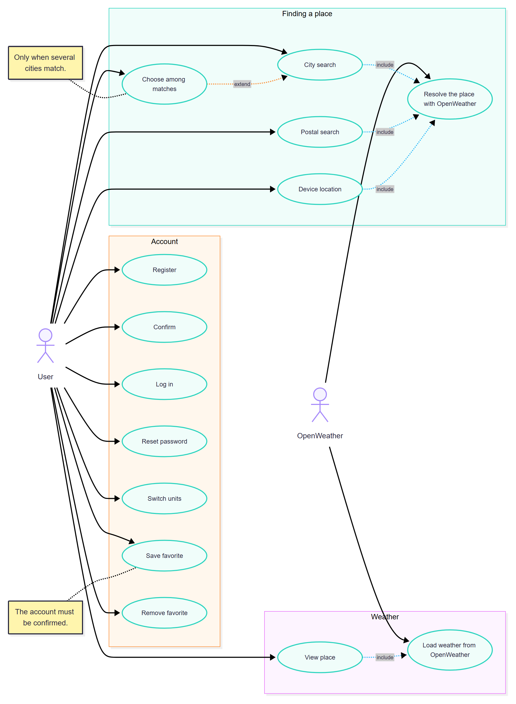
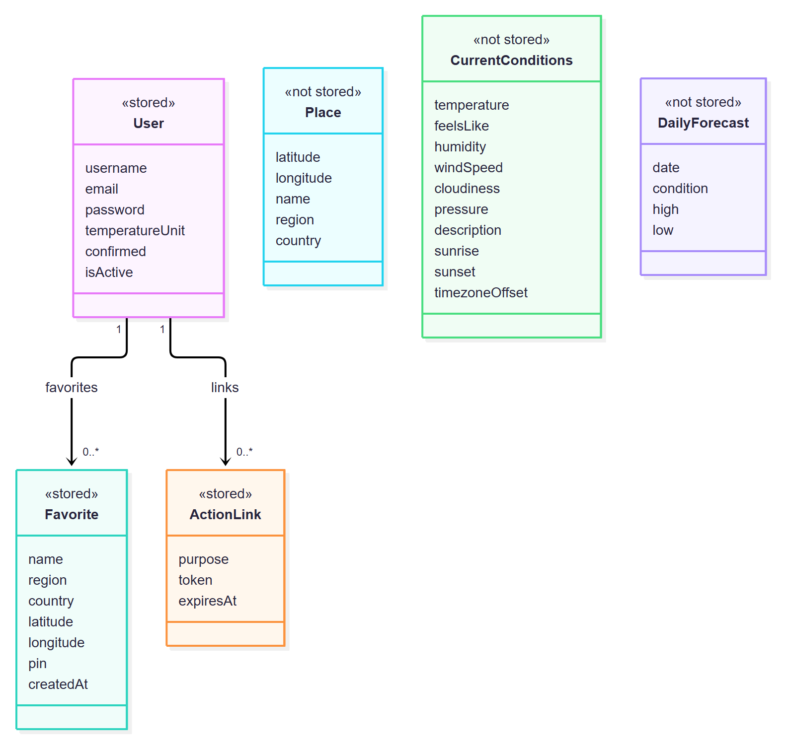
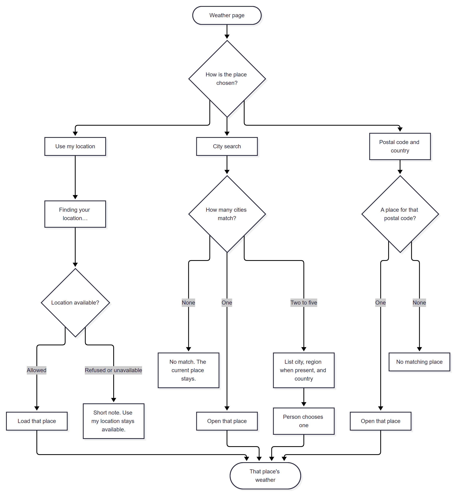
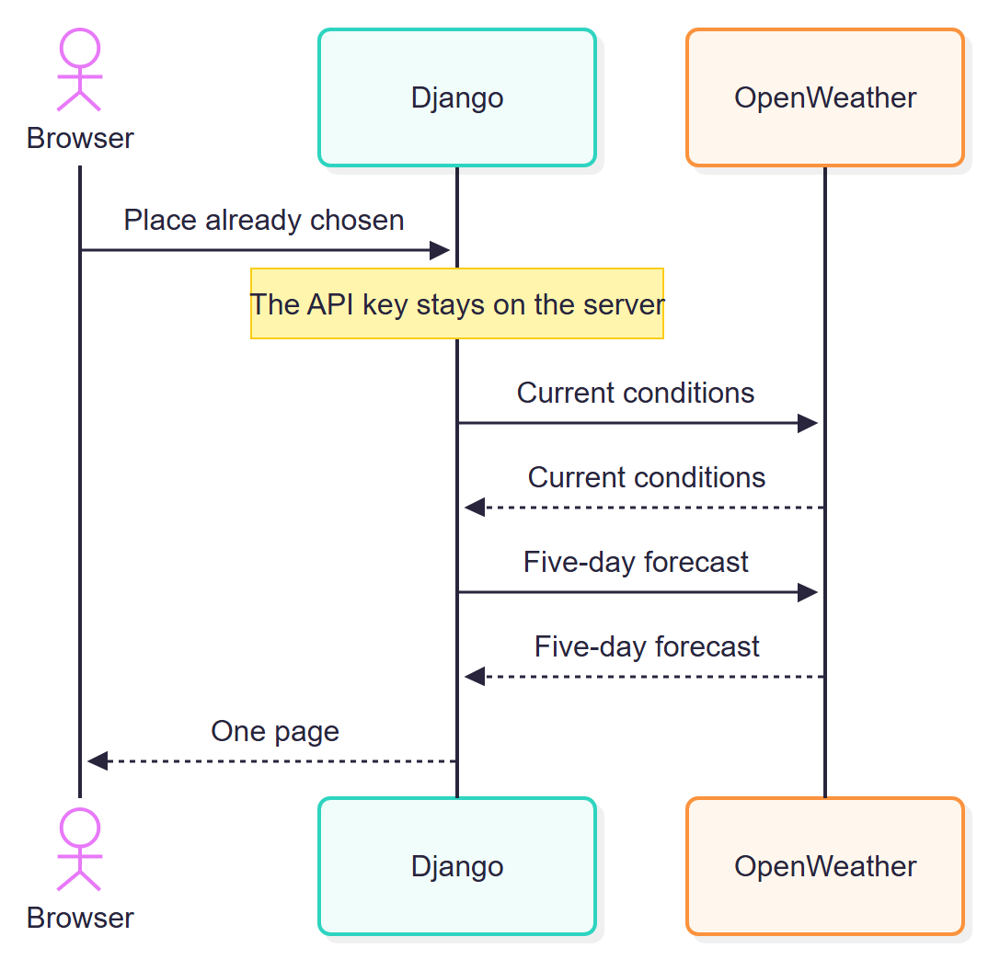
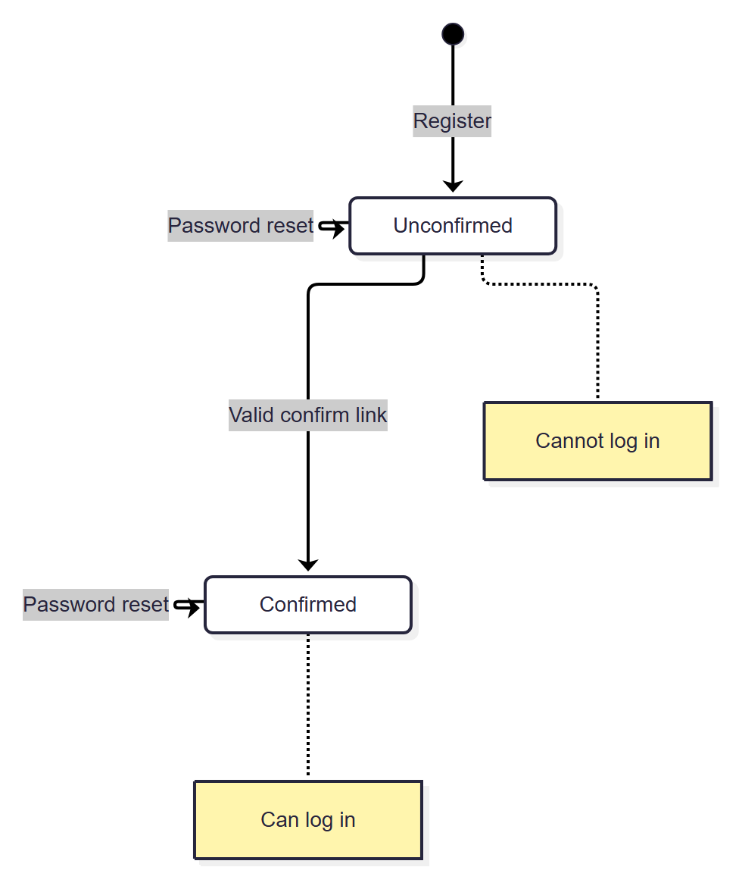

# Weather App

A server-rendered Django weather site. Look up the weather for your current location, any city, or any postal code. See current conditions, a daily forecast, a three-hour temperature line, and the place on a map. Create an account to keep favorite places and your preferred temperature unit.

Weather data comes from [OpenWeather](https://openweathermap.org/api). The browser only talks to this Django app. The server makes every OpenWeather call, so your API key never reaches the page.

## Contents

- [Tech stack](#tech-stack)
- [Install](#install)
- [Run the app](#run-the-app)
- [Test](#test)
- [Using the app](#using-the-app)
- [Requirements](#requirements)
- [UML diagrams](#uml-diagrams)
- [Project layout](#project-layout)
- [Security notes](#security-notes)

## Tech stack

Python 3.13, Django 5.2, SQLite, [uv](https://docs.astral.sh/uv/), server-rendered templates, HTMX, Leaflet with OpenStreetMap tiles, Tailwind CSS and DaisyUI (through `django-tailwind-cli`), Ruff, and pytest.

## Install

You need [uv](https://docs.astral.sh/uv/getting-started/installation/) and a free [OpenWeather API key](https://home.openweathermap.org/api_keys). uv installs the right Python version for you.

```bash
git clone <this repository's URL>
cd weather-app
uv sync
```

Create your environment file from the example and fill it in:

```bash
cp .env.example .env        # Windows PowerShell: Copy-Item .env.example .env
```

```dotenv
OPENWEATHER_API_KEY=your-openweather-key
DJANGO_SECRET_KEY=any-long-random-string
DJANGO_DEBUG=true
```

`.env` is gitignored. Never commit a real key. Without `OPENWEATHER_API_KEY` the site loads, but weather lookups show "Weather could not be loaded."

Create the database:

```bash
uv run python manage.py migrate
```

## Run the app

```bash
uv run python manage.py tailwind runserver
```

This builds the Tailwind CSS and starts the development server at <http://127.0.0.1:8000/>. If you only want the server, use `uv run python manage.py runserver`, but the styles need `tailwind` to have built the CSS at least once.

**Styles missing?** Two things cause this:

- `DJANGO_DEBUG` is not `true`. Django only serves `/static/` files in debug mode, and with no `.env` file it defaults to off, so the CSS returns 404. Create `.env` as shown above.
- On Windows, the Tailwind command can crash printing emoji with a `UnicodeEncodeError`. Run it as `$env:PYTHONUTF8=1; uv run python manage.py tailwind runserver` in PowerShell (`PYTHONUTF8=1 uv run ...` in Git Bash).

The map, HTMX, and Leaflet load from the internet (unpkg and OpenStreetMap), so you need a connection in the browser.

## Test

```bash
uv run pytest            # run the test suite
uv run ruff check .      # lint
uv run ruff format .     # format
```

The tests never call OpenWeather and never read a real API key. `conftest.py` supplies fixed payloads for geocoding, current weather, and the forecast. The suite locks in these behaviors:

- An unconfirmed account cannot log in. An expired confirm or reset link does not confirm the account or change the password.
- City search: no match, one match, and several matches.
- A visitor's unit stays in the session. A signed-in user's unit stays on the account and replaces the session unit at login.
- Favorites belong to one user. Saving the same pin (four decimal places) does not create a second row.
- A failed OpenWeather call leaves the last place on screen.
- The API key never appears in HTML.

The browser location prompt is not driven from the tests. To request a place directly, put it in the query string.

## Using the app

### Find a place

When the weather page opens, search is ready right away and the page says "Finding your location…" while the browser asks for permission.

- **Device location.** Allow the prompt and your place loads. If you refuse, or the device cannot provide a location, a short note replaces that line and search keeps working. **Use my location** stays available to try again.
- **City search.** Type a city. No match shows a short message. One match opens that place. Two to five matches appear as a list (city, region when present, country), and you pick one.
- **Postal search.** Type a postal code, then choose the country from the alphabetical dropdown (for example `10115, Germany`). The lookup returns one place or none.

The selected place is kept in the page address (latitude, longitude, name, region, country), so refreshing or returning after login shows the same place. Conditions and the forecast are always loaded live.

### Read the weather

- **Current conditions:** temperature, feels like, humidity, wind speed, cloudiness, pressure, and sunrise and sunset.
- **Forecast:** one card per day (date, short condition, high, low) and an SVG line of the three-hour temperatures. Hover a point for the time, temperature, and condition.
- **Local time:** highs, lows, day labels, sunrise, and sunset use the place's own time zone.
- **Map:** one marker shows the place name and current temperature on OpenStreetMap.
- **Around the world:** a scrolling row of weather cards for other cities.

If OpenWeather cannot be reached, the weather panel shows a short message. A place already on screen, including its map marker, stays. Search remains usable.

### Switch units

Use the unit switch at the top of the page. Celsius shows wind in meters per second. Fahrenheit shows wind in miles per hour. Pressure stays in hPa. Everyone starts on Celsius. Visitors keep the choice for the visit. Signed-in users keep it on their account, and it replaces the session unit when they log in.

### Create an account

1. Open **Register** and enter a username, an email, and a password twice. Usernames cannot contain `@`.
2. The site shows a simulated confirmation message with a link. No email is sent. Open the link to confirm. You then land on the login form.
3. Until you confirm, login is refused with "Confirm your account first" and a way back to that message. **Show that message again** asks for a username or email and shows the still-valid link, or replaces an expired one.
4. **Log in** with either your username or your email. You return to the page you left.
5. **Reset password** is a second simulated page. Each new request replaces the previous link. After a successful reset you land on the login form. Neither link starts a session.
6. Confirmation and reset links last 24 hours.
7. **Log out** keeps you on the current place. Favorites disappear and the unit falls back to the session.

### Save favorites

Signed-in users can save the current place or a city-search result, open a saved place, and remove one. The newest save is at the top, and each user has their own list. The same pin is never saved twice (latitude and longitude match to four decimal places). A visitor who chooses save goes to login and returns to that place.

## Requirements

These are the product requirements the app implements. Each one is covered by the code and, where noted, by the tests.

### Functional requirements

| ID | Requirement |
| --- | --- |
| FR-1 | Search is available as soon as the weather page loads. While the browser asks for location, the page says "Finding your location…". |
| FR-2 | If the visitor allows location, that place loads. If they refuse or the device cannot provide it, a short note appears, search stays usable, and "Use my location" remains available. |
| FR-3 | City search: no match shows a short message, one match opens that place, and two to five matches are listed (city, region when present, country) for the visitor to choose. |
| FR-4 | Postal search uses an alphabetical English country list and sends the two-letter country code with the postal code. It returns one place or none. |
| FR-5 | The selected place is stored in the query string (latitude, longitude, name, region, country). Refresh and the post-login return rebuild the label from it without geocoding again. |
| FR-6 | Current conditions show temperature, feels like, humidity, wind speed, cloudiness, pressure, and sunrise and sunset. UV is omitted. |
| FR-7 | The forecast shows one card per day (date, short condition, high, low) and an SVG line of the three-hour temperatures with a browser tooltip for time, temperature, and condition. |
| FR-8 | High, low, day labels, sunrise, and sunset use the place's local time from the response's timezone offset. |
| FR-9 | Anyone can switch between Celsius with wind in m/s and Fahrenheit with wind in mph. New visitors and new accounts start on Celsius. |
| FR-10 | A visitor's unit is stored in the session. A signed-in user's unit is stored on the account and replaces the session unit at login. |
| FR-11 | A Leaflet map on OpenStreetMap tiles shows one marker with the place name and current temperature. |
| FR-12 | HTMX updates the weather page in place for city results, the selected place, the unit switch, and adding or removing a favorite. Account screens are full pages. |
| FR-13 | When OpenWeather fails, the panel shows a short message with no stack trace. A place already on screen, including its marker, stays. A first visit with nothing loaded shows the message and no marker. |
| FR-14 | Registration collects a username, an email, and a password twice. Username and email are unique, and usernames cannot contain `@`. |
| FR-15 | After registering, a simulated confirmation page shows a link. No email is sent. Login is refused until the link is opened, with "Confirm your account first" and a way back to the message. |
| FR-16 | "Show that message again" accepts a username or email. A still-valid link is shown again and an expired one is replaced. |
| FR-17 | Opening a valid confirm link marks the account confirmed and shows the login form. It does not start a session. |
| FR-18 | Password reset is a separate simulated page with the new password entered twice. Each new request invalidates the previous link. A successful reset shows the login form and does not start a session. |
| FR-19 | Login accepts a username or an email. A value containing `@` is an email lookup, otherwise a username lookup. |
| FR-20 | Login returns to the page the person left. Logout stays on the current place. |
| FR-21 | A signed-in user can save the current place or a city-search row, open a saved place, and remove one. The newest save is first and each user has their own list. |
| FR-22 | The same pin (latitude and longitude to four decimal places) is saved only once per user. |
| FR-23 | A visitor who chooses save goes to login and returns to that place. Favorites are not available to visitors. |
| FR-24 | Five UML diagrams document the design (see [UML diagrams](#uml-diagrams)). |

### Non-functional requirements

| ID | Category | Requirement |
| --- | --- | --- |
| NFR-1 | Security | The OpenWeather key, the Django secret, and any token salt live only in a gitignored root `.env`. The key never appears in templates, JavaScript, response HTML, query strings, or tests. |
| NFR-2 | Security | The browser talks only to this Django app. Every OpenWeather call is made from the server. |
| NFR-3 | Security | Login uses a Django session cookie. There is no JWT. |
| NFR-4 | Security | The post-login return address must be a relative path on this site. |
| NFR-5 | Security | Confirmation and reset tokens are stored server-side, expire after 24 hours, and are single-purpose. A new reset link invalidates the previous one. |
| NFR-6 | Security | Passwords use Django's built-in validators. Confirmation is its own boolean, separate from Django's `is_active` flag. |
| NFR-7 | Privacy and data | Weather readings are loaded live and never stored. Only accounts, favorites, and action links are stored. |
| NFR-8 | Reliability | An OpenWeather failure degrades gracefully: a short message, the last place kept, and search still usable. |
| NFR-9 | Testability | pytest uses fixed fake payloads, makes no real OpenWeather call, and reads no real API key. |
| NFR-10 | Maintainability | Ruff lints and formats the code. One Django project with an `accounts` app (user and action links) and a `weather` app (favorites, pages, OpenWeather client). |
| NFR-11 | Usability | The interface and weather descriptions are in English. Humidity and cloudiness are percents. Pressure stays in hPa in both unit modes. |
| NFR-12 | Compliance | The map shows the standard OpenStreetMap credit. |
| NFR-13 | Portability | Runs on SQLite with uv and no external services other than OpenWeather and the browser's map and HTMX assets. |

### Out of scope

Real email delivery, UV and the One Call product, stored weather history, JWT, favorite nicknames or drag-to-reorder, Chart.js, more than one map marker, and favorites for visitors.

## UML diagrams

The diagrams are Mermaid pages in [`diagrams/`](diagrams/index.html). Open `diagrams/index.html` in a browser (it loads Mermaid from the internet). Django does not serve them. The images below are rendered from those same pages.

### Use case

User and OpenWeather are the actors. View place includes loading weather. City search, postal search, and device location each include resolving the place with OpenWeather. Choose among matches extends city search only when several cities match. Saving a favorite requires a confirmed account.



### Class

User, Favorite, and ActionLink are stored. A user has zero or more favorites and zero or more action links. Place, CurrentConditions, and DailyForecast are temporary and are not stored.



### Activity

The location journey from the weather page: device location, city search (none, one, or several matches), and postal code with country. Successful branches end on that place's weather. Refusal and no-match are included.



### Sequence

Loading weather for a place that is already chosen. The browser asks Django, Django calls OpenWeather for current conditions and the five-day forecast, and one page comes back. The API key stays on the server.



### State machine

The account lifecycle. Registering creates an unconfirmed account that cannot log in. A valid confirm link makes it confirmed, and a confirmed account can log in. Password reset does not change the state.



## Project layout

```text
config/        Django project settings and URLs
accounts/      Custom user, action links, register, confirm, login, logout, reset
weather/       Weather pages, OpenWeather client, favorites, templates
diagrams/      Mermaid UML pages (static HTML)
docs/          Testing notes, agent docs, and the rendered diagram images
prd/, plans/   Product requirements document and build plan
assets/        Project CSS
```

## Security notes

- Keep your API key in `.env` only. If a key is ever pasted somewhere public, rotate it in your OpenWeather account.
- Confirmation and reset emails are simulated as pages on the site. There is no email backend.
- `DJANGO_DEBUG=true` is for local development only. Set it to `false` and use a real `DJANGO_SECRET_KEY` for anything public.
